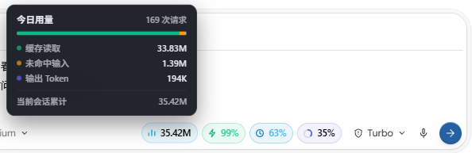
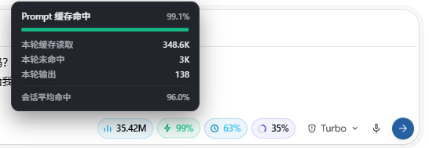
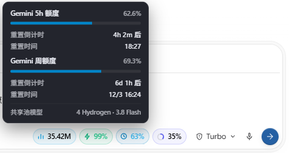
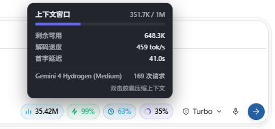
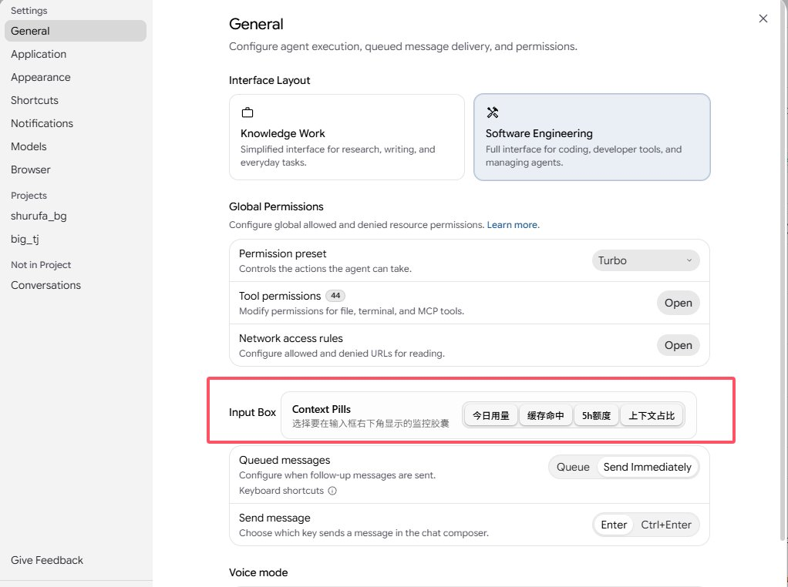

<div align="center">

# Context Pill for Antigravity

Minimalist, zero-dependency status pills right inside the **Google Antigravity** chat composer.  
No `app.asar` patching · No sidebar clutter · No auto-kill relaunch · Native Settings integration

[](plugin.json)
[](#structure)
[](#quick-install)
[](LICENSE)

[简体中文](README.md) · **English**

</div>

---

## ✨ Showcase

Four compact status pills sit cleanly to the left of `Turbo` in the chat composer, expanding rich glassmorphic cards on hover:

<table>
  <tr>
    <td width="50%" align="center">
      <strong>📊 Today's Usage</strong><br/>
      <sub>All conversations today · 3-segment breakdown · Session total</sub><br/><br/>
      
    </td>
    <td width="50%" align="center">
      <strong>⚡ Prompt Cache Hit</strong><br/>
      <sub>Turn cache hit rate · Read / Uncached / Output · Session avg</sub><br/><br/>
      
    </td>
  </tr>
  <tr>
    <td width="50%" align="center">
      <strong>🕒 Gemini 5h & Weekly Quota</strong><br/>
      <sub>5h remaining on pill · 5h & Weekly countdowns on hover</sub><br/><br/>
      
    </td>
    <td width="50%" align="center">
      <strong>○ Context Window</strong><br/>
      <sub>Used / Limit · Decode TPS · TTFT · Double-click to /compact</sub><br/><br/>
      
    </td>
  </tr>
</table>

### ⚙️ Native Settings Integration

Integrated directly into **`Settings → General → Input Box`** to toggle each pill individually:

<div align="center">
  
</div>

---

## 🔥 Highlights

* **Zero Dependencies & Non-Invasive**: Pure Node.js built-in `fetch` + `WebSocket`. Never modifies `resources/app.asar`.
* **Incremental Trajectory Caching**: Unchanged conversations are cached by `lastModifiedTime` for near-zero CPU usage.
* **Auto Chinese / English UI**: Automatically adapts to your Antigravity / system locale.
* **Double-Click `/compact`**: Double-click the Context pill to trigger `/compact` (safely skips if your input box has unsent text).
* **Shadow DOM Isolation**: Light/dark adaptive without touching host styles.

---

## 📦 Structure

```text
context-pill/
├── plugin.json               # Plugin manifest
├── 一键安装.bat / install.sh  # One-click installers (Windows / macOS & Linux)
├── uninstall.bat / .sh       # One-click uninstallers
├── docs/assets/              # Screenshots
└── sidecars/
    └── pill/
        ├── sidecar.json      # Sidecar config (96MB cap, no sidebar)
        ├── main.mjs          # LanguageServer RPC + native WebSocket CDP
        └── widget.js         # Shadow DOM pills + Settings integration
```

---

## 🚀 Quick Install

### 1. Install the Plugin
Download the latest ZIP from [Releases](https://github.com/haijun11/agy-context-pill/releases/latest) (or `git clone`), extract it, and run:
* **Windows**: Double-click **`一键安装.bat`**
* **macOS / Linux**: Run **`bash install.sh`**

### 2. Launch Antigravity with Loopback Debug Port
Add these flags to your Antigravity shortcut or launch script (bound strictly to `127.0.0.1` loopback):

```text
--remote-debugging-port=0 --remote-debugging-address=127.0.0.1
```

---

## 🗑️ Uninstall

Run **`uninstall.bat`** (Windows) or **`bash uninstall.sh`** (macOS / Linux).

## ⭐ Star

If you find this tiny plugin useful, please give it a **Star**!

## 📄 License

[MIT](LICENSE)
