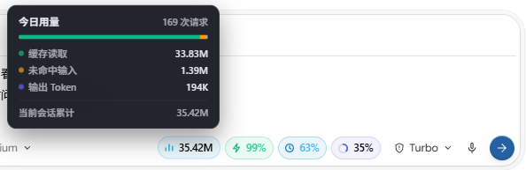
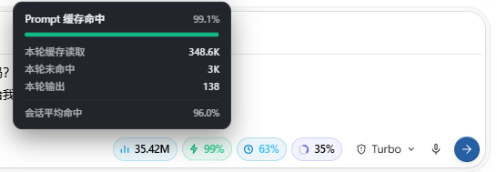
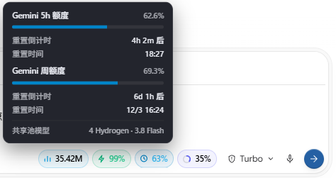
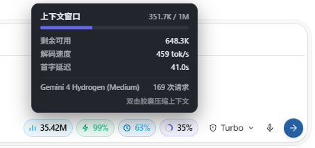
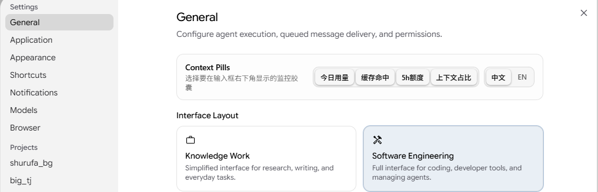

<div align="center">

# Context Pill for Antigravity

一个极简、零第三方依赖的 **Google Antigravity** 输入框监控胶囊插件。  
不改 `app.asar` 安装包 · 无侧边栏打扰 · 不自动杀进程 · 原生设置集成

[](plugin.json)
[](#%E6%9E%81%E7%AE%80%E7%BB%93%E6%9E%84)
[](#%E5%BF%AB%E9%80%9F%E5%AE%89%E8%A3%85)
[](LICENSE)

**简体中文** · [English](README.en.md)

</div>

---

## ✨ 效果展示

四个极简状态胶囊紧贴在输入框右下角 `Turbo` 左侧，平时只占一行极小空间，鼠标悬停即展开精细统计：

<table>
  <tr>
    <td width="50%" align="center">
      <strong>📊 今日用量（Daily Tokens）</strong><br/>
      <sub>当日全部会话总消耗 · 三色分布条 · 当前会话累计</sub><br/><br/>
      
    </td>
    <td width="50%" align="center">
      <strong>⚡ Prompt 缓存命中率（Cache Hit）</strong><br/>
      <sub>本轮缓存命中 · 读取/未命中/输出明细 · 会话平均命中</sub><br/><br/>
      
    </td>
  </tr>
  <tr>
    <td width="50%" align="center">
      <strong>🕒 Gemini 5h & 周额度（Quota）</strong><br/>
      <sub>胶囊显示 5h 剩余 · 浮卡含 5h 与周额度及重置倒计时</sub><br/><br/>
      
    </td>
    <td width="50%" align="center">
      <strong>○ 上下文窗口（Context Window）</strong><br/>
      <sub>已用/上限 · 解码速度 TPS · TTFT · 双击直接压缩上下文</sub><br/><br/>
      
    </td>
  </tr>
</table>

### ⚙️ 原生设置页开关

直接集成在 Antigravity 原生 **`Settings → General`** 顶部（`Interface Layout` 正上方），支持独立开关 4 个胶囊以及一键 **`中文 | EN`** 切换，设置自动持久化：

<div align="center">
  
</div>

---

## 🔥 核心特性

* **零侵入 & 零依赖**：不修改 `resources/app.asar`，无任何 `npm` / `pip` 第三方依赖，纯原生 Node.js `fetch` + `WebSocket` 实现。
* **Shadow DOM 样式隔离**：界面完全封装在 Shadow DOM 内，自适应浅/深色主题，绝不污染宿主样式。
* **双击压缩上下文**：双击 `○ 上下文占比` 胶囊自动填入 `/compact` 并提交压缩（若输入框内已有未发送草稿会自动跳过，防止误覆盖）。
* **极低资源占用**：Sidecar 进程内存上限限制为 `96MB`。

---

## 📦 极简结构

```text
context-pill/
├── plugin.json               # 插件清单
├── 一键安装.bat               # Windows 一键安装并启用
├── uninstall.bat             # Windows 一键卸载清理
├── docs/assets/              # README 展示截图
└── sidecars/
    └── pill/
        ├── sidecar.json      # Sidecar 配置（无侧边栏）
        ├── main.mjs          # 后台采集（LanguageServer RPC + 原生 WebSocket CDP）
        └── widget.js         # 注入 UI（Shadow DOM 胶囊 + 原生设置项）
```

---

## 🚀 快速安装（Windows）

### 1. 一键安装插件
下载本仓库（`Code → Download ZIP` 解压，或 `git clone`），双击运行 **`一键安装.bat`**。  
脚本会自动完成：
1. 复制插件文件到 `%USERPROFILE%\.gemini\config\plugins\context-pill`
2. 在 `%USERPROFILE%\.gemini\config\config.json` 中启用 `context-pill`

### 2. 带本机调试端口启动 Antigravity
由于 Antigravity 未开放输入框内嵌控件的公开插件 API，胶囊通过本机回环调试端口注入。请在你的启动脚本或快捷方式末尾加上：

```text
--remote-debugging-port=0 --remote-debugging-address=127.0.0.1
```

示例 `Antigravity.bat`：
```bat
@echo off
start "" "%LOCALAPPDATA%\Programs\antigravity\Antigravity.exe" --remote-debugging-port=0 --remote-debugging-address=127.0.0.1
```

> 安全说明：`--remote-debugging-address=127.0.0.1` 仅绑定本机回环地址，局域网与外网均无法访问。

---

## 🗑️ 卸载

双击运行 **`uninstall.bat`**，即可自动清理插件目录与配置记录。

## ⭐ 支持一下

如果这个小插件对你有帮助，欢迎点一个 **Star**！

## 📄 License

[MIT](LICENSE)
